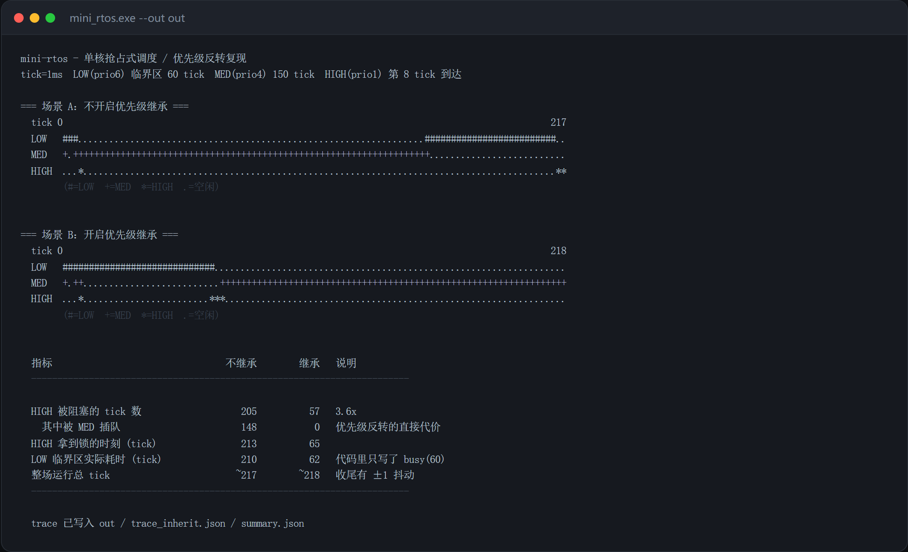
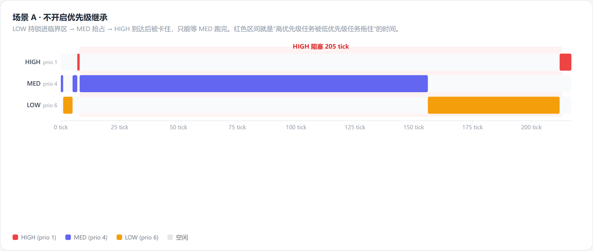
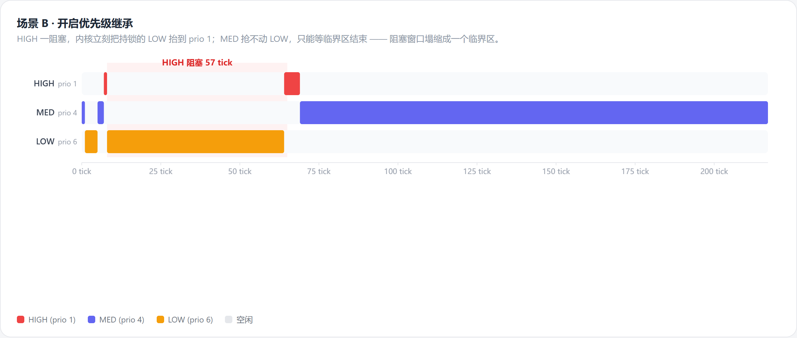
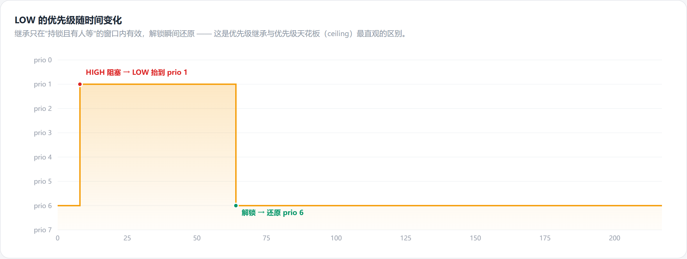

# mini-rtos

一个跑在 PC 上的**单核抢占式 RTOS 内核**，用来复现并量化嵌入式面试里最常被问、最难讲清楚的那个问题：**优先级反转**。

不需要开发板，不需要交叉编译，`gcc` 编译完直接跑，输出 tick 级 trace 和可视化报告：

```
HIGH 被阻塞的 tick 数        不继承 205     继承 57     3.6x
  其中被 MED 插队            148            0
LOW 临界区实际耗时（代码只写了 60 tick）  210   62
```



---

## 为什么做这个

优先级反转是个"人人都能背定义、少数人能说清代价"的知识点。简历上写"了解 FreeRTOS"，面试官追问「优先级继承到底解决了什么、没解决什么」，很难只用嘴讲明白。

真实开发板上复现它需要三样东西：能跑的系统、能打断点的调试器、能画出时序的 trace 工具，缺一样就只能看波形图猜。所以这个项目换个思路：**把调度器自己写一遍**，让所有决策都发生在用户的代码里，这样每一拍 CPU 归属都能记录下来，反转和继承都是可以数出来的 tick。

## 三个任务，一个互斥量

| 任务 | 优先级 | 行为 |
| --- | --- | --- |
| `HIGH` | 1（最高） | 第 8 个 tick 到达，申请互斥量 `M`，拿到后干 5 tick |
| `MED` | 4 | 第 5 个 tick 到达，纯计算 150 tick，**不碰任何锁** |
| `LOW` | 6（最低） | 一开始就拿到 `M`，在临界区里干 60 tick（模拟擦 Flash） |

```
场景 A（不继承）  0        50       100      150      200
LOW   ###..................................................#########################..
MED   +.+++++++++++++++++++++++++++++++++++++++++++++++++............................
HIGH  ...*......................................................................***
                              ↑ HIGH 从 tick 8 一直等到 tick 213

场景 B（继承）    0        50       100      150      200
LOW   #############################.................................................
MED   +.++..........................+++++++++++++++++++++++++++++++++++++++++++++++
HIGH  ...*........................***................................................
                              ↑ HIGH 在 tick 65 就拿到锁
```

`MED` 完全不参与锁竞争，却把 `HIGH` 拖住了 205 个 tick —— 这就是优先级反转。开了继承之后 `LOW` 被临时抬到 `prio 1`，`MED` 抢不动它，`HIGH` 的等待退化成"持锁者剩余工作量"，也就是理论上不可消除的那一部分。




`LOW` 的优先级不是一直高 —— 抬升只在"持锁且有人等"的窗口内有效，解锁瞬间还原：



## 内核是怎么实现的

```
src/rtos.h     TCB、就绪队列接口、互斥量
src/rtos.c     调度器、tick 驱动、优先级继承、trace 导出
src/main.c     三个任务的场景 + 指标统计 + 终端时间线
tools/report.py  把 trace JSON 渲染成单文件 HTML（纯标准库）
```

几个实现上的取舍：

**1. 用线程承载任务栈，但调度权完全在自己手里。**
任务是 `pthread`，可任一时刻只有拿到 `g_lock` 且 `state == T_RUNNING` 的那个能往下走，其余全在 `cond_wait` 上排队。语义上等价于单核 MCU：不会有两条路径同时进临界区。好处是不依赖具体芯片，坏处是 `pthread_cond_wait` 的唤醒延迟会污染时序 —— 下面这条就是为了消掉它。

**2. tick 由调度器单点推进，任务不自己 sleep。**
`busy(n)` 不是 `sleep(n ms)`，而是"等调度器把 `g_tick` 推上去 n 次"，每次推进记一次 CPU 归属。任务的工作量和调度决策同源，连跑 5 次指标完全一致：

```c
void busy(unsigned ticks) {
    for (unsigned i = 0; i < ticks; ++i) {
        pthread_mutex_lock(&g_lock);
        while (g_running && !(g_tasks[me].state == T_RUNNING &&
                              (uint64_t)g_tick > g_tasks[me].consumed))
            pthread_cond_wait(&g_cond, &g_lock);   // 被抢占就在这里等，剩余工作量不丢
        g_tasks[me].consumed = (uint64_t)g_tick;
        pthread_mutex_unlock(&g_lock);
    }
}
```

**3. 优先级继承写了两处，第二处是最容易写错的。**
阻塞时抬高持锁者（`prio = waiter->prio`，记 `inherit` 事件）；释放时**必须还原成 `base_prio`**，不能拿"正在等这把锁的人"的优先级来算 —— 那个等待者马上就被唤醒了，把它算进来会导致优先级永远降不回去。我第一版就踩了这个坑：图上看不出异常（`HIGH` 该多久还是多久），但 `LOW` 一直停在 `prio 1`，等于把 `MED` 永久饿死。

```c
if (s->is_mutex) {
    int restore = g_tasks[me].base_prio;      // 不是 max(等待者)
    if (restore != g_tasks[me].prio) evp("restore", me, restore);
    g_tasks[me].prio = restore;
    s->holder = -1;
}
```

**4. 唤醒 ≠ 能跑。**
被 `sem_post` 唤醒只代表进就绪队列，单核上必须等调度器真的选中它才能继续。所以我写完 `state` 之后还要再等一轮 `T_RUNNING`。少了这一步，`HIGH` 会在 `LOW` 还没解锁时就"穿越"过去。

## 跑起来

```bash
# Windows + MinGW（本机用的是 WinLibs POSIX 版，需要 pthread）
gcc -O2 -std=c11 -Wall -Wextra -o build/mini_rtos.exe src/rtos.c src/main.c -lpthread
./build/mini_rtos.exe --out out

# Linux / macOS 一样，改下输出名即可
gcc -O2 -std=c11 -o build/mini_rtos src/rtos.c src/main.c -lpthread
./build/mini_rtos --out out
```

生成物：

```
out/trace_no_inherit.json   场景 A 的 tick 级 trace（谁在跑 + 事件流）
out/trace_inherit.json      场景 B
out/summary.json            两次运行的指标
docs/report.html            单文件可视化报告（不需要起服务，双击打开）
```

### 确定性自检

```bash
./build/mini_rtos.exe --out out --repeat 5   # 连跑 5 次，指标不一致就以 1 退出
make soak                                    # 同上，CI 里可以直接用
```

这条检查把「同一配置每次跑出来的 tick 数一致」从 README 里的一句话变成可执行断言。
它挡的是这类回归：如果有人把 `busy()` 改回自己 `nanosleep`，任务节奏与调度 tick 就不同源了，
指标会开始 ±1 抖动 —— 普通跑一次看不出来，`--repeat` 会立刻报出来并以非 0 退出。

`--repeat` 只接受 1..1000 的整数：`--repeat 0`、负数或非数字会直接报错退 2，
不会静默跳过自检还报成功（旧行为里 `--repeat 0` 等于把断言关掉，退码仍是 0）。
只写 `--repeat 1` 时会提示"没有可比对的对象"，要断言一致性至少 2 次。

命令行整体是严格的：`--help` 看用法；选项名写错（如 `--rep 5`）、选项后缺值（如只写
`--repeat`）、数值带杂字符（如 `--cs 60x`）都会打一行中文报错并退 2 —— 以前这些情况
一律被静默忽略、按默认值跑完还退 0，CI 里等于没验。

`--json` 只打印一行 JSON，方便接 CI 或脚本对比：

```bash
./build/mini_rtos.exe --json
# {"no_inherit":{"highBlocked":205,...,"medDuringBlock":148},"inherit":{"highBlocked":57,...,"medDuringBlock":0}}
```

## 参数化验证：反转代价到底由什么决定

场景里的「临界区 60 tick、MED 150 tick」本来是写死的，那只能证明「有反转」，证明不了
「反转的代价跟什么有关」。所以把这两个量做成参数（`--cs` / `--med`），跑四组：

| LOW 临界区 | MED 工作量 | HIGH 阻塞（不继承） | HIGH 阻塞（继承） | 倍数 | 不继承时临界区墙钟 |
| ---: | ---: | ---: | ---: | ---: | ---: |
| 60 | 150 | 205 | 57 | 3.6× | 210 |
| 60 | 300 | 355 | 57 | 6.2× | 360 |
| 120 | 150 | 265 | 117 | 2.3× | 270 |
| 120 | 300 | 415 | 117 | 3.5× | 420 |

```bash
./build/mini_rtos.exe --out out --cs 120 --med 300
```

四组数据对上了两个恒等式，这比单个数字有说服力：

1. **不继承时，临界区墙钟 = 临界区 + MED 工作量**。210=60+150、360=60+300、270=120+150、420=120+300，
   四组全中。也就是说 LOW 每被 MED 打断一次，就是整整一个 MED 的工作量被塞进了临界区。
2. **继承时，HIGH 的阻塞 ≈ 临界区长度**（57≈60、117≈120），与 MED 无关——MED 从「插队者」变回「等着的人」。

所以「加了优先级继承就快了 3.6 倍」这个说法是不准确的：倍数是 `MED 工作量 / 临界区长度` 的函数，
MED 越重、临界区越短，反转越致命。表里 2.3× 到 6.2× 的跨度就是这个比值从 1.25 变到 5 的结果。

## 实测数据

| 指标 | 不继承 | 继承 | 说明 |
| --- | ---: | ---: | --- |
| `HIGH` 被阻塞时长 | 205 tick | 57 tick | 从 `sem_wait` 到真正拿到锁 |
| 其中被 `MED` 插队 | 148 tick | 0 | 优先级反转的直接代价 |
| `HIGH` 拿到锁的时刻 | t=213 | t=65 | |
| `LOW` 临界区墙钟耗时 | 210 tick | 62 tick | 代码里只有 `busy(60)` |
| 各任务实际占用 CPU（HIGH/MED/LOW） | 6 / 151 / 60 | 6 / 151 / 60 | **工作量一模一样，变的只是顺序** |
| 上下文切换次数 | 7 | 7 | |

临界区被拉长 3.4 倍、最坏响应时间差 3.6 倍，全部由 `inherit` 一个开关控制。

最后两行值得单独说：两种配置下三个任务各占多少 CPU 完全相同（6/151/60），切换次数也一样，唯一的差别是**谁先谁后**。优先级反转不是"谁多干了活"，而是"关键任务在最不该等的时候等了" —— 这也正是它难以被性能剖析工具发现的原因。

## trace 格式

```json
{
  "tickMs": 1, "ticks": 217, "switches": 7,
  "tasks":  [{"id":0,"name":"HIGH","prio":1,"basePrio":1,"runTicks":6}, ...],
  "owner":  [1, 2, 2, 2, 2, 1, 1, 0, 1, 1, ...],   // 每个 tick 谁占着 CPU，画甘特图用
  "events": [{"t":8,"task":0,"e":"block","p":-1},
             {"t":8,"task":2,"e":"inherit","p":1},
             {"t":64,"task":2,"e":"restore","p":6}, ...]
}
```

`owner` 数组是刻意拍平的：一次运行两百多个 tick，用数组比用区间对象省事，直接喂给 canvas 就能画。开头那几位 `1,2,2,2,2,1,1,0` 对应「id 0 = HIGH / 1 = MED / 2 = LOW」：先由 MED 起头，LOW 拿到锁后被 MED 抢走，第 8 拍 HIGH 才露面。

## 已知局限

- **只支持单核**，没有 SMP 迁移和核间锁；
- **只有一把锁的场景经过验证**，多把互斥量嵌套时的继承还原（该还原到"其余持锁中被等待的最高优先级"）还没写，注释里标了；
- **没有 tickless 低功耗、没有时间片轮转的同优先级公平性**，同优先级按 id 先后；
- 任务栈是真实线程栈，不是从一块 RAM 里切出来的，所以测不出栈溢出 —— 这也不在项目目标内。

## 相关

- 可视化报告：[docs/report.html](docs/report.html)
- 同系列：`fifo-dv`（数字 IP 功能验证）、`micro-infer`（端侧推理内核）、`a2a-agent-hub`（A2A 多智能体网关）
